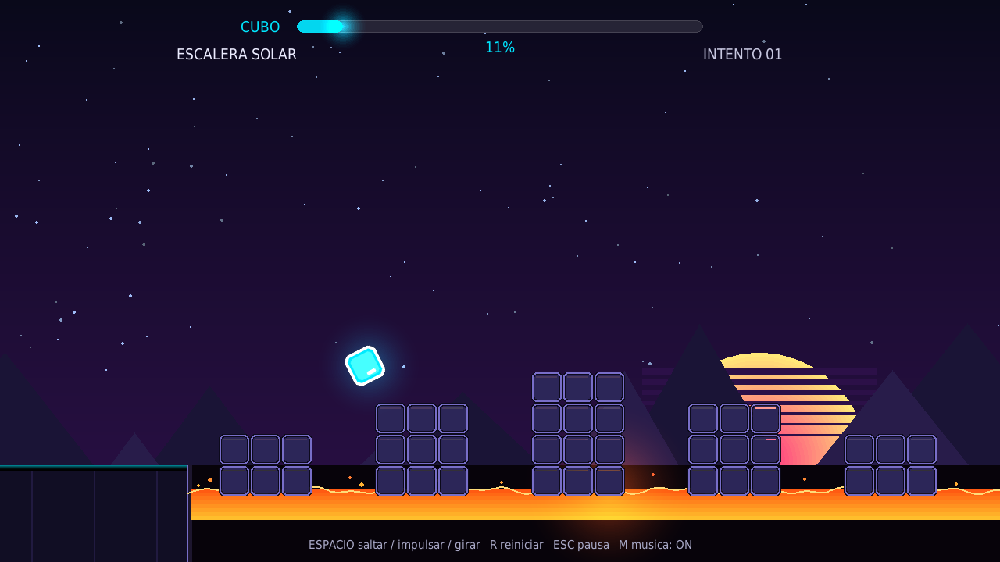

# Neon Dash

Clon jugable de **Geometry Dash** para Linux, escrito en Python con pygame.
Un cubo corre solo, tú solo decides cuándo saltar: pinchos, sierras fijas y
móviles, losas flotantes, escaleras separadas sobre lava, **rampas de impulso**, **orbes de salto** y **portales**
que cambian el modo de juego a nave o a bola. Cada nivel tiene su propio
aspecto y su propia mezcla de obstáculos. Muerte instantánea, reinicio rápido,
barra de progreso, partículas, efectos sintetizados, **música phonk de fondo**
y récords guardados.



## Puesta en marcha

```bash
cd ~/geometry-dash-linux
./run.sh
```

Si acabas de descargar el proyecto, prepara el entorno una vez:

```bash
python3 -m venv .venv
.venv/bin/pip install -r requirements.txt
.venv/bin/python main.py
```

Probado con Python 3.12 y pygame-ce 2.5 (SDL 2.32) en X11/Wayland.

## Controles

| Tecla | Acción |
| --- | --- |
| `Espacio` / `↑` / `W` / clic | Saltar, impulsar la nave o girar la bola |
| `R` | Reiniciar el intento |
| `Esc` | Pausa (y volver al menú desde la pausa) |
| `M` | Música y sonido on/off |
| `F11` | Pantalla completa |
| `P` | Alternar modo normal / práctica (reinicia la partida) |
| `Z` | Guardar punto de control en práctica |
| `X` | Quitar el último punto de control |
| `←` `→` / `↑` `↓` | Elegir nivel en el menú |
| `Espacio` / `Enter` | Empezar |

En modo cubo no hay salto doble: solo se salta desde el suelo. La hitbox real
es algo más pequeña que el dibujo, así que perdona raspones por los bordes.

## Modo práctica

Pulsa **P** en el menú para entrenar. Durante la partida, **Z** guarda un
punto de control y **X** elimina el último (puedes volver a uno anterior).
Al morir reapareces en el último punto, conservando modo, gravedad, orbes,
rampas y posición de las sierras. Si un punto te deja sin salida, elimínalo
con X; R borra todos los puntos y comienza el nivel de nuevo.

La práctica no guarda porcentajes ni niveles completados en los récords
normales. P durante la partida o la pausa cambia de modo y reinicia desde
el principio. Los puntos solo duran la partida actual.

## Modos de juego

| Modo | Control | Qué hace |
| --- | --- | --- |
| **Cubo** | pulsar | Salta. Mantener encadena saltos al aterrizar. |
| **Nave** | mantener | Sube mientras mantienes; al soltar cae. El suelo es seguro, los bloques no. |
| **Bola** | pulsar | Cada pulsación invierte la gravedad; rueda por el suelo o por el techo. |

Los **portales** cambian de modo al atravesarlos: azul → nave, rosa → bola,
verde → cubo. Los **orbes** dan un salto extra en el aire y se activan
manteniendo pulsado al pasar por encima:

- amarillo: salto completo;
- rosa: salto corto;
- azul: invierte la gravedad.

Las **rampas de impulso** (flecha en el suelo) lanzan al cubo mucho más alto
que un salto normal: sirven para cruzar campos de 5 pinchos seguidos. Solo
funcionan en modo cubo y una vez por intento. Las **sierras móviles** suben y
bajan por un carril visible; hay que mirar el ritmo, no solo la posición.

## Siete niveles con recorridos distintos

| Nivel | Dificultad | Recorrido |
| --- | --- | --- |
| Stereo Neon | Fácil | Saltos introductorios, rampas, orbes y escalera sobre lava |
| Violeta Salvaje | Normal | Nave temprana, sierras móviles y losas separadas |
| Órbita Rota | Difícil | Cadena de orbes, nave, bola y escalera final |
| Caos Final | Extremo | Bola, nave densa y plataformas sobre lava |
| Escalera Solar | Normal | Torres escalonadas, rampa sobre lava y peldaños flotantes |
| Islas de Magma | Difícil | Saltos entre losas, vuelo y escaleras de alturas distintas |
| Ruta Fragmentada | Difícil | Escalera de entrada, gravedad invertida, rampa e islas |

Los huecos son reales: si no aterrizas en una losa o bloque, caes a la lava
y mueres. Los peldaños tienen espacios entre sí y cambian de altura; hay
pinchos y sierras intercalados entre los tramos. Las rampas son lanzadores
de impulso, señalados con flechas, que permiten cruzar huecos más largos.

El menú muestra cuatro tarjetas por página. Las flechas recorren los siete
niveles y cambian de página automáticamente; también puedes pulsar las tarjetas.
Cada nivel guarda tu mejor porcentaje y si lo has completado en
`~/.local/share/neon-dash/save.json`. El modo práctica no modifica esos récords.

## Música

La música también se genera en código, sin archivos externos: un bucle de
phonk de 4 compases a 140 BPM en La menor con bombo, caja, charles, 808
saturado y una melodía de campana. Se sintetiza al arrancar (~0,4 s) y se
reproduce en bucle en un canal reservado, así los efectos no la cortan.
`M` la silencia junto con los efectos y la pausa la detiene.

## Cómo está hecho

- `main.py`: motor, física por modos, colisiones, partículas, menú, HUD y
  sintetizador de efectos + música phonk.
- `levels.py`: datos de los niveles y utilidades para escribirlos en celdas.
- `verify.py`: bot que comprueba que los niveles se pueden terminar.

La física usa paso fijo de 1/240 s para que el salto sea idéntico en cualquier
ordenador. Constantes principales en `main.py`:

```python
SPEED   = 400.0   # px/s de avance
GRAVITY = 3400.0  # px/s²
JUMP_V  = 780.0   # impulso del salto
PAD_V   = 1320.0  # impulso de la rampa
```

Con esos valores el salto dura ~0,46 s y avanza ~183 px (4,6 celdas), con una
altura máxima de ~89 px. Por eso los obstáculos consecutivos deben estar a 5
celdas o más: si los juntas más, el nivel se vuelve **imposible**. Las tandas
de pinchos con orbe son la excepción: el orbe alarga el salto y permite
cruzar 4 o 5 pinchos seguidos. Una rampa lanza unos 310 px de largo y 256 px
de alto, suficiente para 5 pinchos (6 justos); los niveles usan 5 por
seguridad.

### Crear o editar niveles

En `levels.py` los patrones se declaran así:

```python
features = [
    ("spike", 1),      # un pincho
    ("spike", 2),      # dos pinchos seguidos
    ("saw", 0),        # sierra de 2x2
    ("platform", 3),   # plataforma de 3 celdas de ancho
]
b, end = build(features, start=9, gap=6)
```

Para un tramo con orbe, una nave o una bola hay ayudantes:

```python
orb_jump(b, col, 5)                  # 5 pinchos + orbe amarillo
orb_jump(b, col, 4, kind="p")        # 4 pinchos + orbe rosa
b.pad(63)                            # rampa de impulso en el suelo
b.spike(64, 5)                       # 5 pinchos justo después
b.saw_move(78, 0, amp=2, period=2.4) # sierra que oscila 2 celdas
ship_section(b, ini, fin, [(ini + 8, "pf"), (ini + 15, "sc")])
ball_section(b, ini, fin, floor_spikes=[...], ceil_spikes=[...])
```

Después de tocar un nivel, comprueba que sigue siendo posible:

```bash
.venv/bin/python verify.py
.venv/bin/python test_practice.py
```

El bot decide una vez por fotograma, como una persona: salta en el último
momento seguro, usa los orbes y las rampas, pilota la nave apuntando al hueco
libre (incluido el barrido de las sierras móviles) y gira la bola antes de
cada pincho. Si falla, conviene revisar el tramo: puede ser un problema del nivel o de la estrategia del bot.

## Problemas típicos

- **No se oye nada**: el sistema de audio no está disponible; el juego
  funciona igual. Puedes comprobar con `M` que no esté silenciado. La música
  phonk se genera al arrancar, así que no falta ningún archivo de audio.
- **Va a tirones**: cierra otras aplicaciones o baja la resolución de la
  ventana; el juego escala un lienzo fijo de 1280x720.
- **Wayland raro**: fuerza X11 con `SDL_VIDEODRIVER=x11 ./run.sh`.

## Aviso

Proyecto educativo hecho desde cero, sin assets ni código de RobTop. Geometry
Dash es una marca de RobTop Games; si quieres el juego original en Linux,
puedes ejecutarlo con Steam/Proton.
